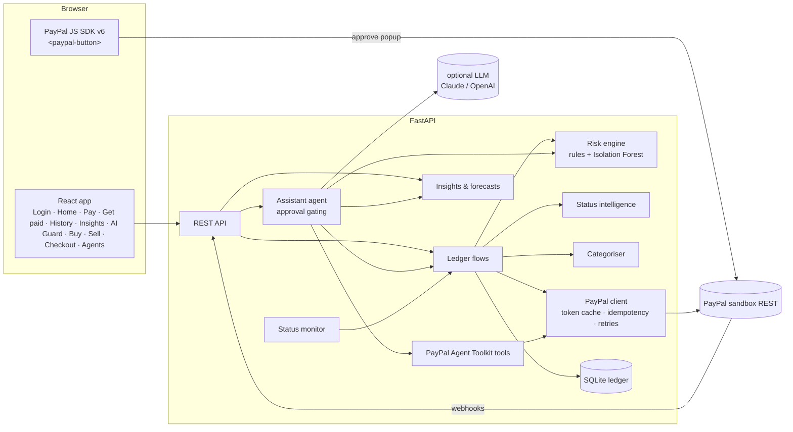

# PayMinute architecture



## Log in with PayPal
1. `GET /api/auth/login` stores a random `state` in the signed session cookie and redirects to `https://www.sandbox.paypal.com/connect` with `scope=openid profile email phone https://uri.paypal.com/services/paypalattributes` and `redirect_uri = APP_BASE_URL/api/auth/callback`.
2. `GET /api/auth/callback?code&state` checks `state`, exchanges the code (`POST /v1/oauth2/token`, `grant_type=authorization_code`), then reads `GET /v1/identity/oauth2/userinfo?schema=paypalv1.1`: name, emails, `payer_id`, `verified_account`, `phone_number`.
3. The session (HTTP-only, signed, 8 h) keeps name, email, payer ID and phone. No PayPal token is stored. Every `/api/*` route except health, config and PayPal webhooks requires it (`AUTH_REQUIRED=true`). `ALLOWED_PAYPAL_EMAILS` can restrict who may sign in.
4. If PayPal returned a phone number, it goes into the **PayPal phone directory** (`paypal_directory`: E.164 → payer ID, source `paypal`). If not, the user can add their own (`POST /api/auth/phone`, source `user`), but never a number PayPal assigned to someone else.

## Payment flows

### Pay by phone (AI Guard + Payouts)
The PayPal sandbox doesn't support Payouts `recipient_type: PHONE`, and no PayPal API reveals who owns a number. PayMinute therefore resolves a number to a PayPal account through the directory above:
1. `POST /api/phone/verify` (AI Guard) runs `ai/phone.py`: libphonenumber validity, country, line type (mobile, landline, VoIP, premium-rate…), carrier; PayPal evidence (`verified` = from PayPal's profile, `linked` = added by the owner, `unknown` / `not_on_paypal`); a noisy-OR score, a verdict and a one-sentence LLM summary. `payable` is true only for valid, linked numbers.
2. `POST /api/payouts/assess` merges the phone signals into the payment's fraud score. A high-risk phone check forces the whole payment to high.
3. `POST /api/payouts` refuses unlinked numbers (`422`), then sends the payout with `recipient_type: PAYPAL_ID` and `receiver = payer_id`. The ledger stores the number in `counterparty_phone`.

### Send money (Payouts)
1. As the user types, `POST /api/payouts/assess` runs the risk engine. No money moves.
2. `POST /api/payouts` with a client-generated `client_ref`:
   - Same `client_ref` again → returns the existing payment (idempotent).
   - High risk without `acknowledge_risk` → `409` plus the assessment (UI requires explicit confirmation).
   - Ledger row is created first, then `POST /v1/payments/payouts` with `sender_item_id = ledger id` and `PayPal-Request-Id = payout-<id>`.
   - The item status is read back (`GET /v1/payments/payouts/{batch}` → item) and stored with its status history.
3. `UNCLAIMED` items can be cancelled (`POST /v1/payments/payouts-item/{id}/cancel`), which returns the money immediately.

### Get paid (Orders v2, authorize first)
1. `POST /api/checkout/orders` creates an order server-side with `intent: AUTHORIZE`, `experience_context` (brand, no shipping, return/cancel URLs), item breakdown and `custom_id = ledger id`.
2. The browser runs the **v6 SDK**: `createInstance` → `findEligibleMethods` → `createPayPalOneTimePaymentSession` → `session.start({presentationMode: "auto"}, createOrder())`.
3. `onApprove` → `POST /api/checkout/orders/{id}/complete`:
   - `POST /v2/checkout/orders/{id}/authorize` → payer name, email, country and authorization ID.
   - The risk engine scores the **payer**. If score ≥ `PAYMINUTE_HOLD_THRESHOLD`, the status becomes `HELD_FOR_REVIEW` and nothing is captured. Otherwise `POST /v2/payments/authorizations/{id}/capture`.
   - The capture may come back `PENDING` with `status_details.reason` (eCheck, PayPal review, …). Status intelligence explains it.
4. The owner can **capture** or **void** (`/v2/payments/authorizations/{id}/void`) held payments, and **refund** completed ones.

### Status monitor
- Webhooks (`/api/webhooks/paypal`): raw body plus the five `PAYPAL-*` headers go to `POST /v1/notifications/verify-webhook-signature`. Events are deduplicated by ID and handled idempotently.
- Background task: every `STATUS_POLL_SECONDS`, refreshes `PENDING / UNCLAIMED / ONHOLD` captures and payout items.
- Each status change is appended to `status_history`. These timelines teach `ai/status.py` how long *this user's* pending payments usually take.

### Transaction Search sync
`GET /v1/reporting/transactions` (last 31 days) → new rows deduplicated by transaction ID → categorised (memory → rules → event codes → LLM batch).

## AI components

| Module | Technique | Output |
|---|---|---|
| `ai/risk.py` | Explainable rules (scam phrases, look-alike/disposable domains, new recipient, amount percentile vs the user's own history, velocity, card-testing pattern, new country, round amounts, duplicates) + **Isolation Forest** (scikit-learn) on per-user features `log(amount)`, hour (sin/cos), 24 h velocity, new-counterparty. Signals combined with noisy-OR. | score 0–1, level, reasons, recommendation |
| `ai/duplicates.py` | Same counterparty + same amount within a window (24 h out / 60 min in), note similarity | duplicate matches |
| `ai/status.py` | Knowledge base of PayPal reason codes and payout statuses + **learned durations** (median time-to-resolution from the user's own status histories when ≥3 examples) | plain-language title, explanation, ETA window, overdue detection, next actions |
| `ai/categorize.py` | User-correction memory → keyword rules → PayPal event codes → **LLM batch classification** | category + source |
| `ai/insights.py` | Month summary, run-rate forecast blended with last month, recurring detection (cadence + amount stability), budget forecasts that separate recurring from variable spend, rule recommendations, **LLM coach** grounded only on the computed numbers | dashboards and tips |
| `ai/agent.py` | LLM tool-calling loop (max 6 steps) over **PayPal Agent Toolkit** tools + PayMinute tools; money-moving or customer-contacting tools are queued as approval actions; deterministic offline planner when no key | chat replies, tool traces, approval cards |

## PayPal Agent Toolkit integration
`paypal/service.py → AgentToolkit` builds the toolkit's `Configuration` with the actions PayMinute enables:

```python
{"invoices": {"create", "list", "get", "send", "sendReminder", "cancel", "generateQRC", "generateInvoiceNumber"},
 "orders": {"create", "get"}, "transactions": {"list"}, "disputes": {"list", "get"}}
```

The toolkit's `PayPalAPI` runs each tool's validated handler. PayMinute swaps in its own client, so toolkit calls share the cached OAuth token, `PayPal-Request-Id`, retries and `debug_id` logging. Tool JSON schemas are made provider-neutral by `llm.sanitize_schema` (inlines `$ref`s, collapses nullable unions).

## Security notes
- Secrets only in environment variables. The browser only receives the public client ID.
- Orders are created and captured server-side, so the amount can't be tampered with in the browser.
- Idempotency on every POST (`PayPal-Request-Id`, `sender_item_id`) plus client-side `client_ref`.
- Webhook signature verification with the raw body. Unverified events get `400`.
- Human-in-the-loop for every agent action that moves money or emails a customer.

## Sponsor integrations
| Integration | Code | Notes |
|---|---|---|
| PayPal MCP server | `integrations/mcp_bridge.py` | MCP client over SSE (`mcp.sandbox.paypal.com/sse`) with a sandbox bearer token; tools replace same-named Agent Toolkit tools; read-only tools run, others need approval |
| Zapier MCP / any MCP server | `integrations/mcp_bridge.py` | Streamable HTTP; tool names prefixed (`zapier__…`); tool lists cached for 10 min; an offline server never breaks the agent |
| AG Studio | `studio.py` (`GET /api/studio/data`, `POST /api/ai/responses`), `frontend/src/pages/studio/*` | Four tables (payments, riskSignals, statusEvents, budgets) with many-to-one relations and a calendar; the AI proxy streams the OpenAI Responses API with the key held server-side |
